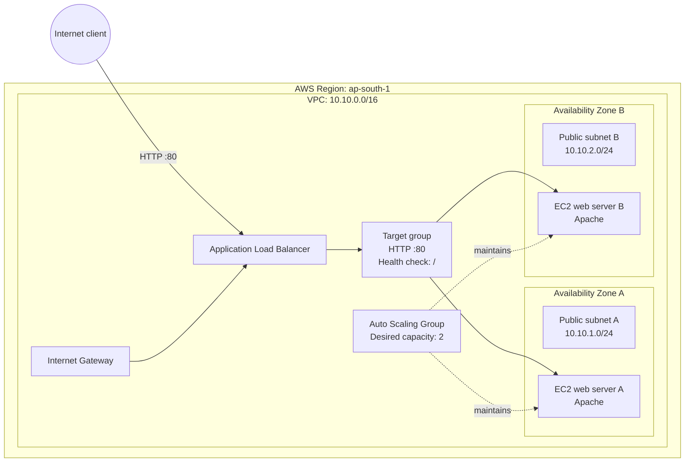

# AWS High-Availability Web Application

A hands-on AWS Cloud Engineering portfolio project focused on VPC networking, application load balancing, EC2 web servers, Auto Scaling, Terraform, and troubleshooting.

This repository is an adaptation of an existing AWS networking lab. The infrastructure code and documentation are being reviewed and customized for a Mumbai-region learning environment. Changes and validation results will be documented as they are completed.
Project status: The source project describes a manual AWS build and a Terraform implementation. This copy has been configured to use the Mumbai region (ap-south-1), but the adapted configuration has not yet been validated or deployed from this repository. Do not treat the source project's deployment screenshots or historical test results as evidence of a deployment performed from this copy.

Project goals
- Understand how a VPC, subnets, route tables, and an Internet Gateway work together.
- Route web traffic through an internet-facing Application Load Balancer (ALB).
- Use target groups and health checks to direct requests to EC2 web servers.
- Learn how an Auto Scaling Group maintains EC2 capacity across Availability Zones.
- Restrict backend access with security-group references.
- Understand IAM instance roles and AWS Systems Manager Session Manager.
- Review infrastructure-as-code configuration with Terraform.
- Practice safe planning, cost awareness, troubleshooting, and teardown.
Technology stack
- Amazon VPC, subnets, route tables, and Internet Gateway
- Application Load Balancer and target groups
- Amazon EC2, Auto Scaling, and Amazon Linux
- IAM and AWS Systems Manager
- Terraform
- Apache HTTP Server
- Linux, Git, and GitHub
Region and configuration
- AWS Region: Mumbai (ap-south-1)
- VPC CIDR in the current configuration: 10.10.0.0/16
- Public subnet A: 10.10.1.0/24
- Public subnet B: 10.10.2.0/24
- Web listener: HTTP on TCP port 80
- Configured web instance count: 2 by default, with input validation limiting it to one or two instances
The Terraform provider reads the region from var.aws_region. The default in variables.tf and the example value in terraform.tfvars.example have been changed to ap-south-1. Review any future variable files or environment variables before running Terraform, because explicit values can override defaults.
Architecture overview
The intended architecture has an internet-facing ALB in two public subnets. The ALB forwards HTTP requests to a target group containing EC2 web servers across two Availability Zones. An Auto Scaling Group manages the desired number of instances.

This diagram describes the intended design, not proof that the current copy has been deployed. Confirm the actual Terraform resources and outputs before relying on specific implementation details.
Request flow
1. A client resolves the ALB DNS name.
2. The client connects to the ALB over HTTP port 80.
3. The ALB listener forwards the request to the target group.
4. The target group selects a healthy EC2 target.
5. Apache returns the web response through the ALB.
6. Requests may be served by different backend instances.
Security concepts to review
The source configuration describes the following security model. Verify the actual rules in the Terraform files before deployment.
Component	Intended inbound access	Purpose
ALB security group	HTTP 80 from the internet	Accept web requests
EC2 security group	HTTP 80 from the ALB security group only	Prevent direct public web access to backend instances
EC2 administration	Systems Manager with an instance role and outbound connectivity	Manage instances without inbound SSH

Security groups are stateful: return traffic for permitted connections is automatically allowed. The source design uses public subnets for cost-controlled outbound connectivity, so the instances should not be described as residing in private subnets unless the architecture is changed.
Repository layout
.
├── architecture/
│   └── architecture.md
├── docs/
│   ├── images/
│   ├── manual-build.md
│   ├── teardown.md
│   ├── troubleshooting.md
│   └── validation.md
├── scripts/
│   └── user-data.sh
├── terraform/
│   ├── compute.tf
│   ├── iam.tf
│   ├── load_balancer.tf
│   ├── locals.tf
│   ├── network.tf
│   ├── outputs.tf
│   ├── providers.tf
│   ├── security.tf
│   ├── terraform.tfvars.example
│   ├── variables.tf
│   └── versions.tf
├── web/
│   └── index.html
├── .gitignore
└── README.md
Working with the Terraform configuration
Terraform is not required just to read or edit this repository. To validate or deploy the infrastructure later, install Terraform using HashiCorp's official instructions and configure AWS credentials for an account you are authorized to use.

From the project root:
cd terraform
Review the configuration before running any commands that interact with AWS. When ready to validate:
terraform init
terraform fmt -check
terraform validate
terraform plan
- terraform init downloads the required provider and initializes the working directory.
- terraform fmt -check checks formatting without changing files.
- terraform validate checks configuration syntax and internal consistency.
- terraform plan previews proposed infrastructure changes; review it carefully before any apply.
Do not run terraform apply until you understand the plan, confirm the AWS account and region, and have reviewed expected costs. Destroy lab resources after testing and verify the result. AWS Budget alerts are not real-time spending caps.
Troubleshooting topics
The source documentation includes a Session Manager connectivity case study. The key concept is that the SSM Agent initiates outbound TLS connections to Systems Manager; inbound SSH is not required for Session Manager. If Session Manager cannot connect, investigate the instance role, SSM Agent status, DNS and network reachability, and outbound HTTPS access.

Treat the existing troubleshooting notes and screenshots as source-project documentation until you reproduce the scenario or collect your own evidence.
Current limitations and future improvements
The source design identifies these areas for further work:
- Use HTTPS with AWS Certificate Manager and an appropriate DNS setup.
- Evaluate private subnets and a suitable outbound connectivity design.
- Store Terraform state in a secured remote backend with locking.
- Add VPC Flow Logs, ALB access logs, alarms, and dashboards.
- Automate Terraform formatting, validation, and security checks with CI.
- Perform and document an Auto Scaling instance-replacement test.
- Evaluate dynamic scaling policies based on workload metrics.
These are planned improvements, not completed features, until implemented and verified in this repository.
Validation log
Record your own results here as you complete them. Include the date, commands run, configuration reviewed, outcome, and sanitized evidence.
Check	Status
Mumbai region values updated in variables.tf and terraform.tfvars.example	Completed; file values checked
Terraform formatting and validation	Not yet run in this copy
AWS deployment from this copy	Not yet performed
ALB and target health checks from this copy	Not yet performed
Auto Scaling replacement test from this copy	Not yet performed
Teardown verification from this copy	Not yet performed

Attribution and licensing
This repository retains the original MIT LICENSE file and its required copyright and permission notice. The project is being adapted from an existing AWS networking lab. New changes should be documented clearly, and any additional copyright notice should apply only to original contributions actually created for this adaptation.
Cost and security checklist
Before deploying:
- Confirm the AWS account and region.
- Review the full Terraform plan.
- Check for secrets, credentials, state files, and saved plans before committing.
- Understand which resources may incur charges, including load balancers and EC2 instances.
- Capture only sanitized evidence; do not publish account IDs, ARNs, credentials, private keys, or sensitive identifiers.
- Destroy lab resources when finished and verify that they were removed.
This is a learning and portfolio project. Do not present the architecture as production-ready or claim deployment and validation results that have not been independently reproduced.