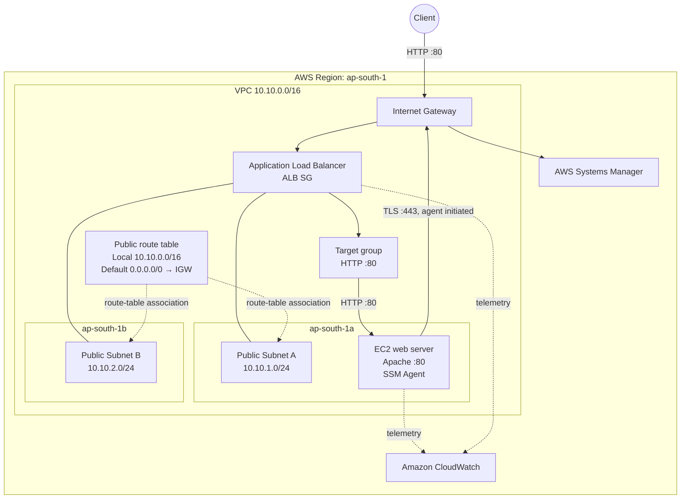

# Architecture and traffic flows

## Logical architecture



## Application data path

| Step | Source | Destination | Control |
|---|---|---|---|
| 1 | Internet client | ALB listener | ALB SG permits inbound TCP 80 |
| 2 | ALB | Target group | Listener forwards HTTP requests |
| 3 | Target group | EC2 private address | EC2 SG permits TCP 80 from the ALB SG |
| 4 | EC2 | ALB/client | Return traffic is allowed by stateful security groups |

The ALB is the only intended public entry point for the application. The EC2 rule references the ALB security group instead of permitting `0.0.0.0/0`.

## Management path

The SSM Agent on EC2 initiates an outbound HTTPS connection to Systems Manager. The path is:

```text
EC2 SSM Agent
  → EC2 security-group outbound rule (TCP 443)
  → subnet default route (0.0.0.0/0)
  → Internet Gateway
  → AWS Systems Manager service endpoint
```

The return traffic is part of the established connection, so an inbound security-group rule is not required. No SSH key pair or inbound TCP 22 rule is used.

## Routing

| Destination | Target | Purpose |
|---|---|---|
| `10.10.0.0/16` | `local` | Communication inside the VPC |
| `0.0.0.0/0` | Internet Gateway | Internet-reachable ALB and outbound AWS API access |

Both public subnets are associated with the public route table.

## Availability and failure domains

The ALB is associated with two subnets in separate Availability Zones. This satisfies the ALB's multi-AZ placement requirement and makes the load-balancer layer resilient to a single-AZ failure.

The application layer contains only one EC2 target in Availability Zone A. If that instance or AZ fails, no second target can serve requests. A production-oriented next phase would add private application subnets and an Auto Scaling group maintaining at least one healthy target in each AZ.
