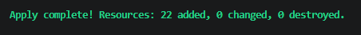
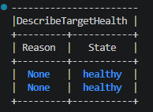
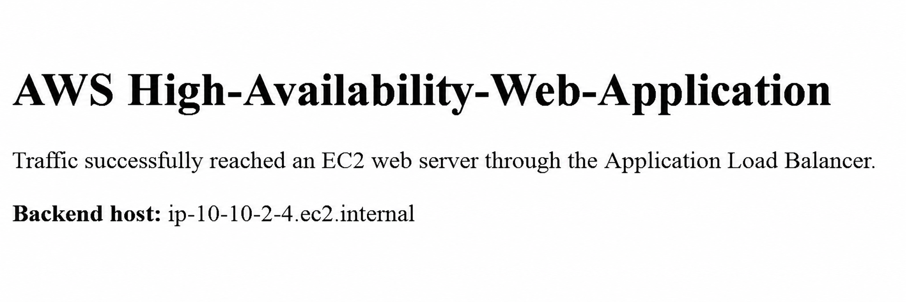
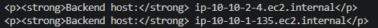

# Terraform Implementation — Phase 2

**Status:** Completed, validated, and destroyed successfully.

This phase rebuilt and improved the manually created AWS networking lab using Terraform. The implementation provides a repeatable two-AZ architecture with an internet-facing Application Load Balancer, two EC2 web servers managed by an Auto Scaling Group, Systems Manager permissions, and security-group-based traffic controls.

## Architecture implemented

* Custom VPC using `10.10.0.0/16`
* Two public `/24` subnets across two Availability Zones
* Internet Gateway and public route table
* Internet-facing Application Load Balancer
* HTTP listener on TCP port 80
* Target group with HTTP health checks
* Launch template using Amazon Linux 2023
* Auto Scaling Group maintaining two `t3.micro` instances
* Apache installation through EC2 user data
* IAM role and instance profile for Systems Manager
* IMDSv2 required on EC2 instances
* Encrypted `gp3` root volumes
* No SSH key pair or inbound port 22
* Restricted security-group references between the ALB and web tier

## Traffic and security model

| Source             | Destination           | Protocol/port | Purpose                               |
| ------------------ | --------------------- | ------------: | ------------------------------------- |
| Internet           | ALB security group    |        TCP 80 | Public HTTP access                    |
| ALB security group | EC2 security group    |        TCP 80 | Application traffic and health checks |
| EC2 security group | AWS services/internet |       TCP 443 | Systems Manager and package access    |

The EC2 instances do not accept HTTP directly from the internet. Their inbound rule references the ALB security group, ensuring that web traffic must pass through the load balancer.

The instances receive public IPv4 addresses only to provide outbound connectivity without introducing a NAT Gateway into this cost-controlled lab. No inbound rule permits direct internet access to the instances.

## Terraform file structure

| File                       | Purpose                                                             |
| -------------------------- | ------------------------------------------------------------------- |
| `versions.tf`              | Terraform and AWS provider version requirements                     |
| `providers.tf`             | AWS provider configuration and default tags                         |
| `variables.tf`             | Configurable region, network, project, and compute values           |
| `locals.tf`                | Naming convention and common resource tags                          |
| `network.tf`               | VPC, subnets, Internet Gateway, and routing                         |
| `security.tf`              | ALB and EC2 security groups and standalone rules                    |
| `iam.tf`                   | EC2 trust policy, SSM role, policy attachment, and instance profile |
| `load_balancer.tf`         | ALB, listener, target group, and health checks                      |
| `compute.tf`               | AMI lookup, launch template, and Auto Scaling Group                 |
| `outputs.tf`               | ALB URL, VPC, subnet, target group, and ASG outputs                 |
| `terraform.tfvars.example` | Safe example variable values                                        |
| `.terraform.lock.hcl`      | Reproducible provider selection                                     |

## Prerequisites

* Terraform `1.10` or newer, but below `2.0`
* AWS CLI v2
* An AWS IAM Identity Center or other authorized AWS CLI profile
* Permissions to create the documented VPC, EC2, IAM, Auto Scaling, and ELB resources

This project uses temporary AWS IAM Identity Center credentials instead of long-lived access keys.

Example PowerShell authentication:

```powershell
aws sso login --profile your-sso-profile
$env:AWS_PROFILE = "your-sso-profile"
aws sts get-caller-identity --profile your-sso-profile
```

Do not commit credentials, access tokens, account IDs, or environment-specific endpoints.

## Initialize and validate

From this directory:

```powershell
terraform init
terraform fmt -check
terraform validate
terraform plan
```

Expected validation result:

```text
Success! The configuration is valid.
```

The completed lab produced a plan containing 22 Terraform-managed resources.

## Deploy using a saved plan

Create a saved plan:

```powershell
terraform plan -out=lab.tfplan
```

Review the plan before applying it. In particular, verify that it contains no unexpected NAT Gateways, Elastic IP resources, databases, or unrelated services.

Apply exactly the reviewed plan:

```powershell
terraform apply .\lab.tfplan
```

## Outputs

After deployment:

```powershell
terraform output
terraform output -raw alb_url
terraform output -raw autoscaling_group_name
```

The `alb_url` output provides the public HTTP entry point. Clients should access the ALB rather than either EC2 instance directly.

## Validation results

The Terraform deployment was validated successfully:

* Terraform reported 22 resources added.
* Two EC2 targets registered as healthy.
* The ALB returned `HTTP/1.1 200 OK`.
* The custom Apache page loaded through the ALB.
* Repeated requests displayed two different backend hostnames, demonstrating load distribution.
* The infrastructure was destroyed after validation.
* `terraform state list` returned no remaining managed resources after teardown.

| Terraform deployment                                                      | Healthy target group                                                |
| ------------------------------------------------------------------------- | ------------------------------------------------------------------- |
|  |  |

| ALB web response                                                          | Multiple backend responses                                                            |
| ------------------------------------------------------------------------- | ------------------------------------------------------------------------------------- |
|  |  |

## Teardown

Destroy the environment when testing is complete:

```powershell
terraform plan -destroy
terraform destroy
terraform state list
```

Always review the destruction plan before confirming. An empty `terraform state list` after a successful destroy confirms that Terraform no longer tracks deployed resources.

AWS service-linked roles or other account-level resources created automatically by AWS should not be deleted without understanding their purpose.

## State and repository safety

The repository intentionally excludes:

* `.terraform/`
* `*.tfstate`
* `*.tfstate.*`
* `*.tfvars`
* Saved Terraform plan files
* Credentials, keys, and tokens

The `.terraform.lock.hcl` file is committed because it records the selected provider version and supports reproducible initialization.

This learning project currently uses local Terraform state. The deployed environment must be destroyed before deleting or losing the local state file.

## Cost controls

This phase intentionally avoids a NAT Gateway and other unnecessary recurring resources. An account-wide AWS Budget was configured separately, and the infrastructure was applied, tested, documented, and destroyed during the same working session.

AWS budget notifications are monitoring controls rather than real-time hard spending limits. Prompt teardown remains the primary cost-control mechanism for this lab.

## Current limitations

* HTTP is used instead of HTTPS.
* EC2 instances reside in public subnets for cost-controlled outbound connectivity.
* Auto Scaling maintains two fixed instances but has no dynamic scaling policy.
* Terraform state is local rather than stored in a secured remote backend.
* A controlled instance-failure and automatic-replacement test remains a future validation exercise.
* Automated Terraform checks are not yet running through GitHub Actions.

## Future enhancements

1. Move the web tier into private subnets.
2. Evaluate Systems Manager VPC endpoints or a NAT design.
3. Add HTTPS with AWS Certificate Manager and Route 53.
4. Configure an S3 backend with state locking.
5. Add VPC Flow Logs, ALB access logs, alarms, and dashboards.
6. Add GitHub Actions for `terraform fmt`, `validate`, and security scanning.
7. Perform and document an Auto Scaling self-healing test.
